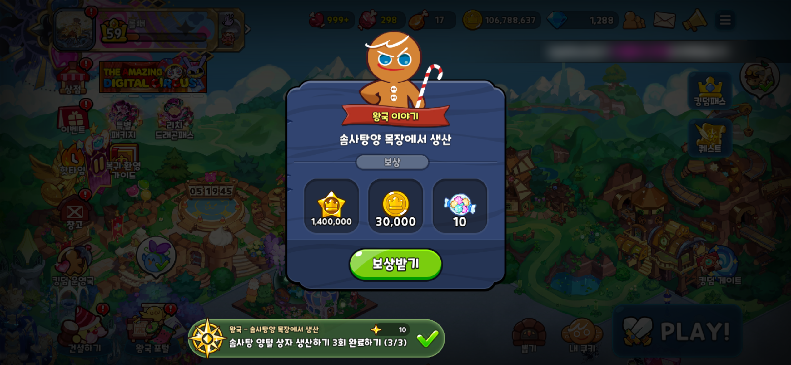
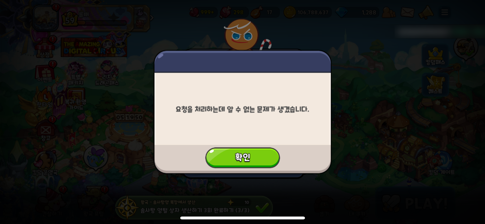
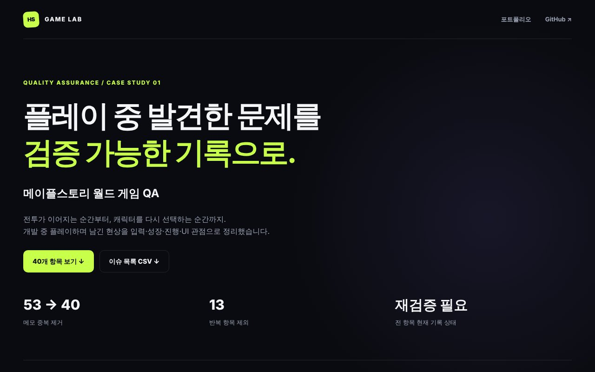
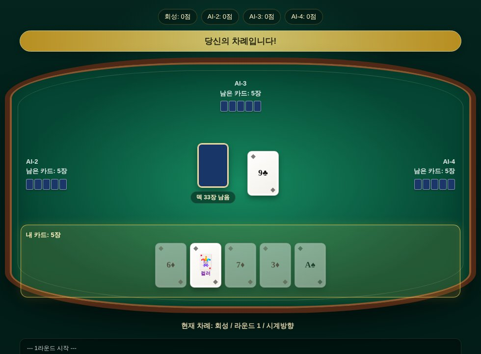
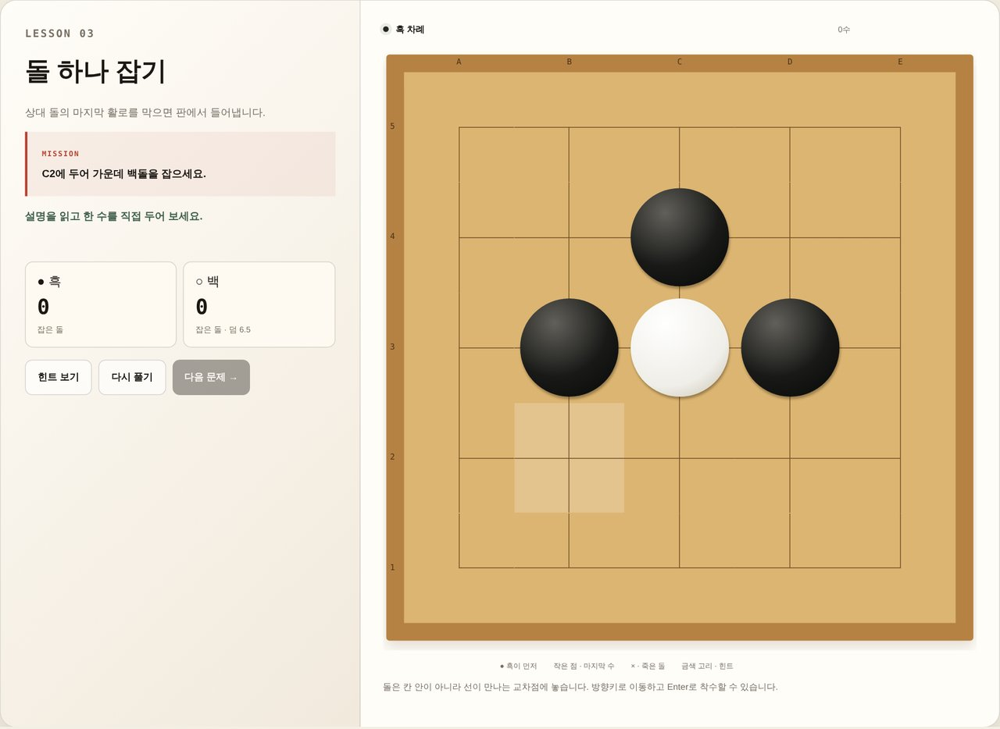
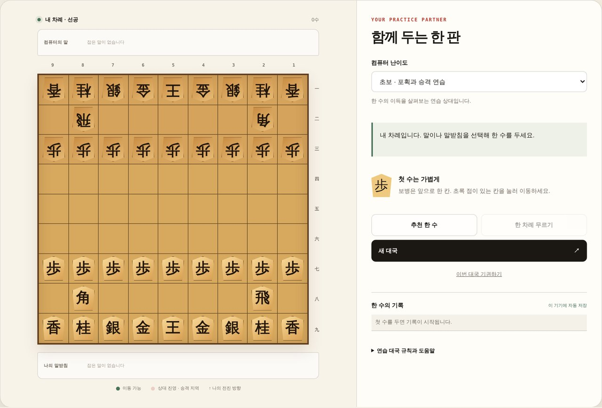
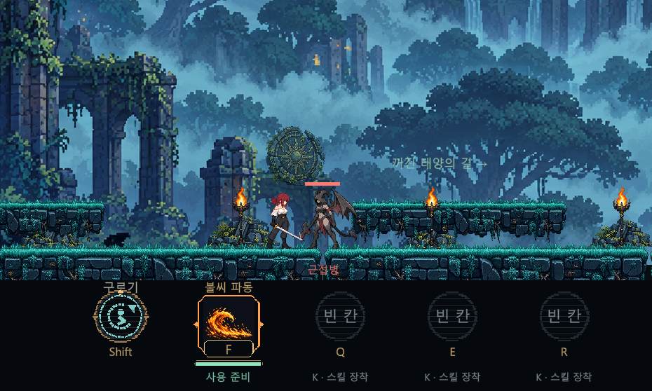
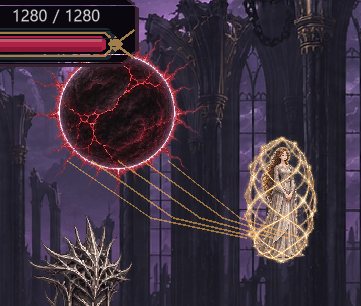
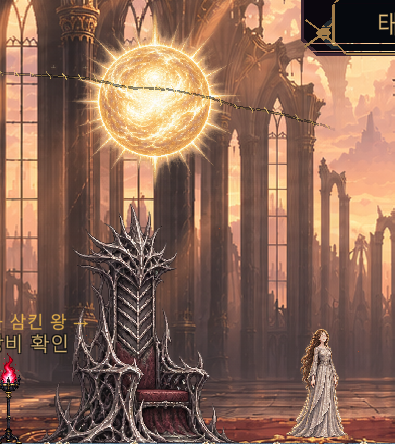

# 정회성 | 게임 QA 포트폴리오

> 플레이하며 발견한 문제를 **재현 절차 · 기대 결과 · 우선순위**로 기록하고, 고친 뒤에는 **다시 깨지지 않는지** 확인합니다.

유한대학교 게임콘텐츠학과 졸업 · 컴퓨터소프트웨어전공 전공심화과정 재학 (2027.02 졸업 예정) · sakakinji@naver.com

**[QA 사례 모음](qa/README.md)** · **[웹게임 플레이](https://onecard-game.onrender.com)** · **[Notion QA 포트폴리오](https://app.notion.com/p/QA-20182c4386db83f595c901951a88e9d8)**

## 한눈에 보기

| 항목 | 내용 |
| --- | --- |
| 플레이 QA | 메이플스토리 월드 게임 이슈 **40건** (P1 10 · P2 21 · P3 9), 원카드 플레이 이슈 **25건** |
| 자동화 테스트 | 웹게임 테스트 **88개 실행, 88/88 통과** (2026-11-04, Node.js 22) · SUNFALL 핵심 로직 검사 **18/18 통과** |
| 버그 리포트 | 출시 게임 버그 1건(쿠키런: 킹덤), SUNFALL 기존 결함 분석 3건 + 최근 상세 리포트 7건 (재검증 대기) |
| 밸런스 QA | 장비 효과가 체감되지 않는 문제를 몬스터 HP 대비 처치 타수로 분석해 수치 조정 |
| 테스트 환경 | PC(Windows)·웹 브라우저, iPhone 16e(iOS 27.0.1)에서 출시 게임 플레이 중 버그 발견 · 모바일 QA 실무 경험은 아직 없습니다 |
| 도구 | Unity 6 · C# · NUnit · JavaScript · Node.js(node:test) · Git/GitHub · Markdown |

## QA 사례

### 1. 게임하면서 찾은 버그들 — 쿠키런: 킹덤

출시된 모바일 게임을 플레이하며 발견한 버그를 재현 절차·기대/실제 결과·스크린샷으로 기록합니다.

| No. | 게임 | 버그 | 심각도 |
| --- | --- | --- | --- |
| [001](qa/game-bug-reports/001-cookierun-kingdom-quest-reward-error.md) | 쿠키런: 킹덤 | 퀘스트 보상 수령 후 보상받기를 누르면 "알 수 없는 문제" 오류가 반복 발생 | Major |

 

[전체 목록](qa/game-bug-reports/README.md)

### 2. 메이플스토리 월드 게임 — 플레이 이슈 40건

메이플스토리 월드 글로벌 개발 콘테스트 준비 프로젝트를 직접 플레이하며 남긴 메모 53개에서 중복 13개를 제거해 **고유 이슈 40건**으로 정리했습니다.

- 유형: 결함 제보 21 · 개선 제안 11 · 확인 필요 6 · 기능 확인 2
- 영역: UI 9 · 입력 6 · 리소스 6 · 성장 5 · 진행 4 · 스킬 4 · 전투 3 · 기타 3
- 관찰 / 기대 결과 / 재검증 절차를 분리하고, 취소선만으로 수정 완료를 추정하지 않았습니다.
- 집중 분석: 화면 전환에 따라 능력치가 **920 → 520 → 620**으로 변하는 문제, 강화 수치 미반영(UI 누락인지 계산 누락인지 분리), 사용권 소멸(정책상 정상 차감인지 먼저 확인)



[40건 보고서](qa/maple-worlds-qa.md) · [CSV](web-games/public/qa/maple-worlds/issues.csv) · [사례 페이지](https://onecard-game.onrender.com/qa/maple-worlds/index.html)

### 3. 웹게임 — 원카드 플레이 이슈 + 자동화 테스트 88개

원카드를 플레이하며 발견한 규칙·UI 문제 25건을 요청과 처리 결과로 기록했습니다.

| 발견한 문제 | 판정 | 처리 |
| --- | --- | --- |
| 조커를 낸 뒤 낼 수 있는 카드가 없어 진행이 막힘 | 규칙 결함 | 조커 이후 제출 조건 완화 |
| AI 대전에서 카드를 내자마자 원카드 선언 전에 걸림 | 타이밍 결함 | 선언 판정 시점을 AI 차례 직전으로 이동 |
| 덱이 0장일 때 공격받아도 카드를 안 받음 | **정상 동작** | 정상임을 확인하고 "카드 부족" 안내 추가 |
| 카드가 부족해 게임이 끝나지 않음 | 교착 결함 | 한 바퀴 지급 불가 시 라운드 강제 종료 |

버그처럼 보여도 명세상 정상인 경우를 구분하고, 정상이라도 플레이어가 오해하지 않도록 안내를 추가했습니다. 쇼기·바둑·스토리 게임의 규칙·UI·온라인 대국은 자동화 테스트 88개로 검증합니다.

| 원카드 AI 대전 | 바둑 입문 문제 | 쇼기 컴퓨터 연습 |
| --- | --- | --- |
|  |  |  |

[웹게임 QA](qa/web-games-qa.md) · [원카드 QA 원본](qa/onecard-qa.docx) · [테스트 코드](web-games/tests/)

### 4. SUNFALL (Unity 2D 액션, 개발 중) — 테스트 설계 · 결함 분석 · 밸런스

현재 개발 중인 액션 게임(7스테이지까지 구현)에서 만들면서 QA를 함께 진행하고 있습니다. **PC 기준이며 모바일은 아직 대응하지 않았습니다.**

- **테스트 케이스 14개:** 입력·전투·진행·보상·저장·개발자 도구
- **직접 플레이 QA:** 관찰·제보 30개 묶음, 최근 결함 상세 리포트 7건 (스크린샷 6장, 재검증 체크리스트 10개)
- **결함 분석 3건:** 착지 후 공격 상태 잔류, 투명도 계산 오류로 인한 캐릭터 깜빡임(불투명도 0.75), UI 겹침
- **Windows QA 빌드:** 다른 PC에서 실행 가능한 EXE 배포 (2026-11-05 빌드)
- **회귀 테스트:** 인식·추적 및 최종 귀환 조건 등의 테스트 소스 추가. 최신 Core / Runtime / Editor / Tests 컴파일 확인, 테스트 실행 결과는 별도 관리
- **밸런스:** 장검 보너스 +10% → +30%로 중갑병 처치 타수 4타 → 3타

| SF-R01 적 재인식 안 됨 (P1) | SF-R06 각진 연결선 (P2) | SF-R07 결말 미진행 (P1) |
| --- | --- | --- |
|  |  |  |

**[본인 기획·제작 활동](sunfall/07-work-and-decisions.md)** · **[직접 플레이 QA 누적 30개 묶음](qa/sunfall-user-qa-history.md)** · **[최근 제보 7건·스크린샷·재검증](qa/sunfall-regression-2026-11-06.md)**

2026-11-06 최신 게임 소스와 모션 에셋을 반영했습니다. 기존 2026-11-05 EXE는 이전 버전입니다. 최신 플레이 QA는 미실행입니다.

[SUNFALL QA 문서](qa/sunfall-qa.md) · [게임 문서](sunfall/README.md) · [Unity 프로젝트](game/README.md) · [Windows QA 다운로드](https://github.com/sakakinji-maker/game-project-docs/releases/tag/sunfall-qa-2026.11.05-1)

## 제작 프로젝트

게임은 기획 방향·기능 요구·플레이 피드백을 바탕으로 AI 코딩 도구(Codex 등)와 협업해 구현했습니다. 개인 역할은 기획, 요구사항 정의, 플레이 피드백, QA 기록입니다.

| 프로젝트 | 장르 | 자료 |
| --- | --- | --- |
| SUNFALL — 별을 꿰매는 마녀 | Unity 2D 횡스크롤 액션 (개발 중) | [문서](sunfall/README.md) |
| 한 수씩 배우는 쇼기 | 튜토리얼·AI·온라인 대국 | [플레이](https://onecard-game.onrender.com/shogi/) |
| 한 수씩 배우는 바둑 | 입문 문제·AI·온라인 대국 | [플레이](https://onecard-game.onrender.com/baduk/) |
| 원카드 | 2–4인 온라인 카드 게임 | [플레이](https://onecard-game.onrender.com/onecard/) |
| 10년 뒤에 나를 찾아줘 | 15챕터 스토리 미스터리 | [플레이](https://onecard-game.onrender.com/unfinished/) · [기획서](05_아직_끝나지_않은_문장_기획서.md) |
| 핵전쟁 서바이벌 | 회피·생존 액션 | [플레이](https://onecard-game.onrender.com/survival/) |
| 대한민국 생태계교란종 잡기 | 교육형 턴제 RPG | [플레이](https://onecard-game.onrender.com/ecodex/) |
| 애프터라이트: 마지막 도시 | 수집·방치형 RPG (기획 단계) | [기획서](06_애프터라이트_게임기획서.md) |

[웹게임 프로젝트 상세](web-games/PROJECTS.md) · [전체 스크린샷](screenshots/README.md) · 플레이 링크는 배포 서버 상태에 따라 열리지 않을 수 있습니다.

## 저장소 구조

| 경로 | 내용 |
| --- | --- |
| [qa/](qa/) | QA 보고서 (메이플스토리 월드, 웹게임, SUNFALL) |
| [web-games/](web-games/) | 웹게임 6종 서버·클라이언트·자동화 테스트 |
| [game/](game/) · [sunfall/](sunfall/) | SUNFALL Unity 프로젝트와 문서 |
| `05_`, `06_*.md` | 스토리 게임 기획서·대본·인물 설정, 애프터라이트 기획서 |
| [screenshots/](screenshots/README.md) | 포트폴리오·지원서에 사용한 화면 모음 |
| [drafts/](drafts/) | 작성 중인 기획 초안 |

## 테스트 실행

```bash
cd web-games
npm ci
npm test     # 자동화 테스트 88개
npm start    # http://localhost:3000
```

SUNFALL은 [game/README.md](game/README.md) 안내대로 Unity 6000.3.27f1에서 `game/Sunfall`을 열고, Window → General → Test Runner로 EditMode 테스트를 실행합니다.
