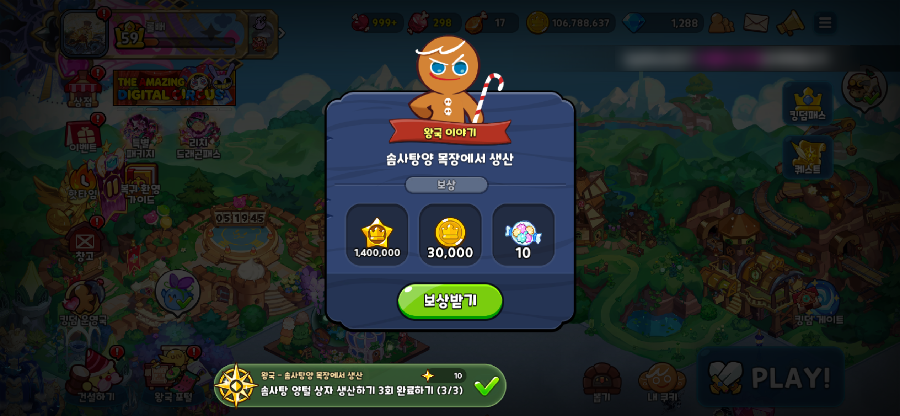
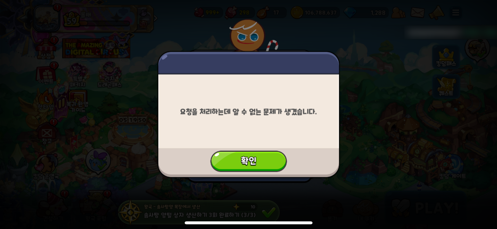

# BUG-001 퀘스트 보상 수령 후 보상받기를 누르면 "알 수 없는 문제" 오류 반복

[게임하면서 찾은 버그들](README.md)

## 요약

| 항목 | 내용 |
| --- | --- |
| 게임 | 쿠키런: 킹덤 |
| 영역 | 퀘스트 (왕국 이야기) / 보상 수령 |
| 대상 퀘스트 | 왕국 – 솜사탕양 목장에서 생산: **솜사탕 양털 상자 생산하기 3회 완료하기 (3/3)** |
| 심각도 / 우선순위 | Major / P2 — 오류가 반복되어 퀘스트 흐름을 정상적으로 이어가기 어려움 |
| 재현 빈도 | 반복 발생 (보상받기를 누를 때마다) |
| 기기 | iPhone 16e (iOS) |
| 게임 버전 / iOS 버전 | 미기록 |
| 계정 | 레벨 59 |
| 발견 일시 | 2026-10-31 17:47 |
| 상태 | 미해결 · 재현 확인 중 |

## 재현 절차

1. 퀘스트 **"솜사탕 양털 상자 생산하기 3회 완료하기"** 를 진행해 3/3으로 완료합니다.
2. 화면 하단 퀘스트 알림을 눌러 **왕국 이야기 – 솜사탕양 목장에서 생산** 보상 창을 엽니다.
3. **보상받기**를 눌러 보상을 받습니다.
4. 보상을 받은 뒤 다시 보상 창의 **보상받기**를 누릅니다.

## 기대 결과

- 보상은 한 번만 지급되고, 지급 후에는 보상 창이 닫히거나 보상받기 버튼이 비활성화되어야 합니다.
- 이미 받은 보상이라면 "이미 수령한 보상입니다" 같은 안내가 나와야 합니다.
- 다음 퀘스트로 정상 진행되어야 합니다.

## 실제 결과

- 보상받기를 누르면 **"요청을 처리하는데 알 수 없는 문제가 생겼습니다."** 오류 창이 나타납니다.
- 확인을 누른 뒤 다시 시도해도 같은 오류가 **계속 반복**됩니다.
- 하단 퀘스트 알림은 계속 **(3/3) 완료 상태**로 남아 있습니다.

## 스크린샷

| 1. 보상 창 (보상: 경험치 1,400,000 · 코인 30,000 · 솜사탕 아이템 10) | 2. 보상받기 후 오류 창 |
| --- | --- |
|  |  |

## 관찰 내용

- 두 스크린샷 사이 화면의 타이머는 05:19:45 → 05:19:50으로, 약 5초 간격입니다.
- 오류 전후 보유 코인이 **106,788,637로 같아**, 화면상으로는 보상이 중복 지급되지 않은 것으로 보입니다.
- 오류 문구가 원인을 알려주지 않아, 플레이어는 보상이 정상 지급됐는지 판단하기 어렵습니다.

## 추가 확인 항목

외부 플레이어로서 원인은 확인할 수 없으므로 추정하지 않고, 아래 조건을 나눠 재현 범위를 좁힐 계획입니다.

- [ ] 게임을 완전히 종료 후 재접속해도 같은 보상 창과 오류가 나타나는지
- [ ] 우편함·보유 재화에서 보상(경험치·코인·아이템)이 실제로 1회 지급됐는지
- [ ] 다음 왕국 이야기 퀘스트가 열리는지, 퀘스트 진행이 막히는지
- [ ] Wi-Fi / 모바일 데이터 등 네트워크 환경을 바꿔도 발생하는지
- [ ] 다른 왕국 이야기 퀘스트 보상에서도 같은 현상이 있는지
- [x] 기기 모델 기록 (iPhone 16e)
- [ ] iOS 버전, 게임 버전 기록 (게임 설정 화면 또는 앱스토어에서 확인)

## 개선 제안

- 이미 처리된 보상 요청이면 일반 오류 대신 "이미 받은 보상입니다"처럼 상태를 알려주고 창을 닫습니다.
- 보상받기를 누른 직후 버튼을 비활성화해 같은 요청이 반복 전송되지 않도록 합니다.
- 오류 창에 오류 코드를 함께 표시하면 고객 문의 시 원인 추적이 쉬워집니다.
