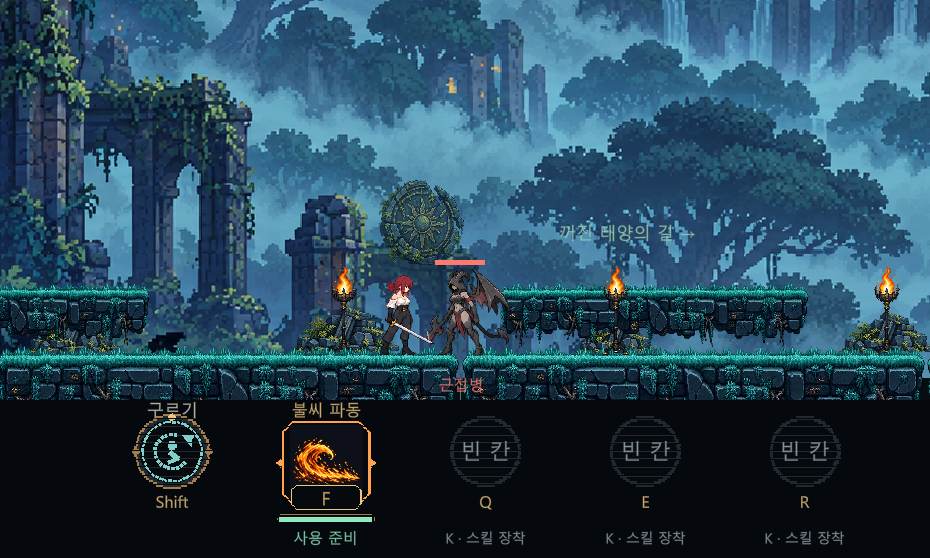
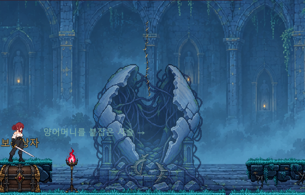
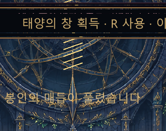
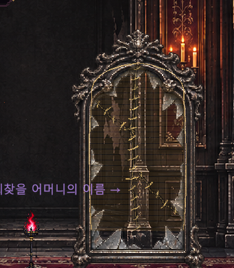
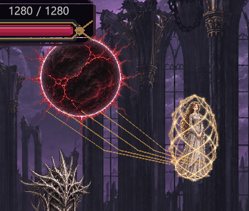
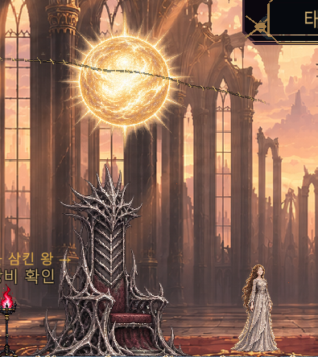

# SUNFALL 최근 결함 리포트 · 2026-11-06 정리

[누적 사용자 QA](sunfall-user-qa-history.md) · [전체 QA](sunfall-qa.md) · [최신 소스 변경](../game/Sunfall/docs/RELEASE_NOTES_2026_11_06.md)

제보자: 프로젝트 사용자. 근거: 대화의 직접 플레이 관찰과 첨부 스크린샷 6장. 스크린샷의 실제 촬영일·실행 빌드 번호·해상도 설정·재현 빈도는 확인되지 않았으며 문서 날짜는 **정리일**입니다.

공통 상태: **코드 수정 및 컴파일 확인 / 사용자 수동 재검증 대기**. 아래 원인은 코드에서 확인한 수정 대상입니다. Codex가 Play로 현상을 재현하거나 수정 결과를 검증한 기록은 아닙니다. P1/P2/P3는 재검증 순서를 위한 제안 우선순위입니다.

## SF-R01 · 근접해도 재인식하지 않는 적 — P1

- **관찰:** “내가 앞에 있어도 인식을 했다가 다시 돌아오니까 인식이 안되는 버그”. 첫 스크린샷에서 주인공 가까이에 근접병이 있음.
- **기대:** 보이는 적에게 다시 접근하면 방향을 잡고 추적·공격을 재개.
- **수정 대상:** 일반 적은 공격 거리 밖에서 이동하더라도 `MinX/MaxX` 순찰 경계에 막혔음. 화면 판정은 머리부터 발까지 전부 화면 안에 있어야 활성화되어, 카메라 이동 중 몸 일부가 보이는 적도 비활성화될 수 있었음.
- **수정:** 지상 적은 현재 방의 지상 범위 안에서 추적. 발판 위 적은 기존 발판 경계를 유지. 화면과 적 몸의 겹침으로 가시성 판단. 검 3타 넉백도 같은 지상 경계를 써서 옛 순찰 구역으로 순간이동하지 않도록 통일.
- **관련 소스:** [RunModel.CombatView.cs](../game/Sunfall/Assets/Sunfall/Core/RunModel.CombatView.cs), [RunModel.cs](../game/Sunfall/Assets/Sunfall/Core/RunModel.cs).
- **회귀 소스:** `VisibleTorsoKeepsWindupWhenFeetAreBelowCamera`, `GroundGuardReacquiresPlayerAcrossPatrolBoundary`. 기존 화면 밖 궁수 검사는 유지하며 완전히 화면 위에 있는 조건을 명확히 함. **테스트 작성·컴파일만 확인, 실행하지 않음.**

## SF-R02 · 2층 봉합선이 봉인 구조물 위에 떠 있음 — P2

- **관찰:** 보스 처치 후 열린 껍질 위 빈 공간에 가느다란 세로 봉합선이 보임.
- **기대:** 사슬 해방과 봉합이 해당 구조물의 균열에 연결되어 보임.
- **수정:** 공통 세로선 호출 대신 열린 껍질 내부를 잇는 곡선으로 좌표·길이·굵기 조정.
- **관련 소스:** [SunfallGame.Crypt.cs](../game/Sunfall/Assets/Sunfall/Runtime/SunfallGame.Crypt.cs), `DrawRestorationScar`.

## SF-R03 · 3층 봉합이 평행한 막대처럼 보임 — P2

- **관찰:** 천체 장치 중앙에 길고 평행한 금빛 선이 반복됨.
- **기대:** 장치에 붙어 있는 자연스러운 실의 봉합 자국.
- **수정:** 이전 11개 직선 반복을 제거하고 배경 천체 장치에 고정된 곡선 봉합과 잔광으로 연결.
- **관련 소스:** [SunfallGame.SolarBoss.cs](../game/Sunfall/Assets/Sunfall/Runtime/SunfallGame.SolarBoss.cs).

## SF-R04 · 5층 거울 봉합에 줄무늬와 어색한 면이 생김 — P2

- **관찰:** 거울 내부에 직사각형 띠가 겹치고 봉합과 복구 표현이 부자연스러움. 이전에는 봉합이 너무 작고 보이지 않는다는 피드백도 있었음.
- **수정 대상:** 투명한 다각형을 가로 스캔라인으로 채우던 복구 면이 화면 배율에 따라 줄무늬처럼 보일 수 있는 방식이었음.
- **수정:** 면 채우기를 제거하고 기존 정상 거울 이미지의 반사를 서서히 복구. 그 위에 가는 중심 봉합과 짧은 가지 봉합을 배치.
- **관련 소스:** [SunfallGame.MirrorSanctum.cs](../game/Sunfall/Assets/Sunfall/Runtime/SunfallGame.MirrorSanctum.cs).

## SF-R05 · 6층 처치 후 봉합 표현 수정 요청 — P2

- **근거:** 사용자 텍스트로 별도 요청. 이번 묶음에는 6층 처치 후 상태를 명확히 식별할 수 있는 별도 스크린샷이 없음. 7층 어머니 스크린샷을 6층 증거로 사용하지 않음.
- **수정:** 일식 중앙의 공통 세로 봉합을 제거하고, 일식이 사라진 자리의 폭에 맞춘 가로 아치형 곡선과 잔광으로 변경. 배경의 시차 이동을 따라가도록 유지.
- **관련 소스:** [SunfallGame.EclipseTower.cs](../game/Sunfall/Assets/Sunfall/Runtime/SunfallGame.EclipseTower.cs).
- **재검증 핵심:** 보스 전투 중 일식/장막의 범위와 처치 후 봉합 위치를 각각 확인. 가시성과 분위기는 사용자 판단 필요.

## SF-R06 · 7층 태양과 어머니의 연결이 부자연스러움 — P2

- **관찰:** 태양에서 어머니 몸으로 여러 각진 직선이 부채꼴로 이어짐. 처치 이후에는 금빛 태양을 봉합선이 가로지름.
- **수정:** 태양 테두리와 포획체 상단에 끝점이 고정된 두 곡선으로 교체. 해방 시 점차 사라지며, 마지막 하늘 봉합은 태양 원반을 가르지 않고 상단 테두리를 따라가게 배치.
- **관련 소스:** [SunfallGame.FinalThrone.cs](../game/Sunfall/Assets/Sunfall/Runtime/SunfallGame.FinalThrone.cs).

## SF-R07 · 최종 보스 후 결말로 이어지는 흐름이 불명확함 — P1

- **관찰:** “7스테이지 보스 끝나고 아무것도 없어”. 어머니가 내려온 상태에서 다음 행동이 명확하지 않음.
- **수정 대상:** 기존에도 먼 출구 포탈에서 ↑를 누르면 승리 결과로 전환되었으나, 구출된 어머니 앞에는 종료 상호작용이 없었음. ‘엔딩 코드가 전혀 없다’고 기록하지 않음.
- **수정:** 최종 보스 처치 연출과 스킬 선택을 마친 뒤 어머니 근처 지상에서 ↑로 결말 진입. 머리 위 이름표와 HUD에 안내. 기존 출구 경로도 유지. 상자와 겹친 경우 먼저 상자 1회 개방을 처리하고 다음 입력으로 종료할 수 있음.
- **결말 화면:** 되찾은 태양 배경, 양어머니 이미지와 마지막 대사, 처치 수, 마을 귀환·장비 확인·새 모험 버튼.
- **관련 소스:** [RunModel.cs](../game/Sunfall/Assets/Sunfall/Core/RunModel.cs), [SunfallGame.Ending.cs](../game/Sunfall/Assets/Sunfall/Runtime/SunfallGame.Ending.cs).
- **회귀 소스:** `FinalBossAllowsEndingBesideMotherAfterRewardChoice`. 최종 보스 처치 전, 보상 선택 전, 상자 획득, 어머니 앞 종료 조건을 기록. **컴파일만 확인, 실행하지 않음.**

## 수정 후 재검증 체크리스트 — 전 항목 미실행

| ID | 절차 | 기대 결과 | 결과 |
|---|---|---|---|
| R-01 | 1층 근접병에게 접근 → 기존 순찰 구역 밖으로 이탈 → 다시 접근 | 지상 범위에서 추적·방향 전환·공격 재개 | 대기 |
| R-02 | 점프로 카메라를 올려 적의 발만 가림 → 착지 | 몸통이 보이는 동안 인식이 계속됨 | 대기 |
| R-03 | 궁수를 화면 완전히 밖에 둔 뒤 재접근 | 숨은 상태에서는 발사하지 않고 다시 보이면 공격 | 대기 |
| R-04 | 상층 적을 발판 끝으로 유인, 지상 적을 순찰 경계 밖에서 3타로 밀기 | 상층 적은 추락하지 않으며 지상 적은 원래 순찰 위치로 튀지 않음 | 대기 |
| R-05 | 2·3층 처치 후 좌우 이동·점프로 카메라 변경 | 껍질·천체 장치와 봉합이 함께 움직임, 공중 부유·막대 표현 없음 | 대기 |
| R-06 | 5층 처치 후 창 크기/해상도 변경 | 거울 복구 면에 가로 줄무늬 없이 반사와 봉합 표시 | 대기 |
| R-07 | 6층 전투 → 처치 → 좌우 이동 | 전투 효과는 범위 유지, 처치 후 봉합은 일식 자리와 일치 | 대기 |
| R-08 | 7층 등장부터 해방·하강까지 관찰 | 두 연결선은 포획체 상단에 연결되고 해방 시 사라짐 | 대기 |
| R-09 | 7층 보상 선택 전 어머니 앞 ↑ → 선택 후 상자 획득 → 어머니 앞 ↑ | 조기 종료 방지, 보상 1회 지급, 결말 화면 진입 | 대기 |
| R-10 | 결말에서 장비 확인 / 마을 귀환 / 새 모험 각각 확인 | 버튼 정상 동작, 장비·재화·성장 보존 규칙 유지 | 대기 |

재검증 시에는 소스 커밋 또는 새 빌드 버전, 환경, 실제 결과, 스크린샷을 추가합니다. 기존 `sunfall-qa-2026.11.05-1` EXE에는 이 수정이 없으므로 이 체크리스트의 수정 검증용으로 사용하지 않습니다.
