# 스크린샷 모음

[포트폴리오 홈](../README.md) · [QA 사례 모음](../qa/README.md)

포트폴리오와 입사지원서에 사용한 화면입니다. 웹게임 화면은 이 저장소의 `web-games` 코드를 로컬에서 실행해 2026-11-10에 캡처했으며, 화면 구석의 AI 도우미 채팅창은 가리고 찍었습니다.

## QA 사례 화면

| 쿠키런: 킹덤 BUG-001 | |
| --- | --- |
| 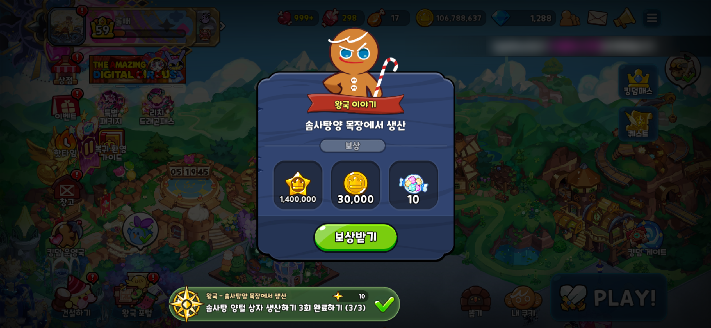 | 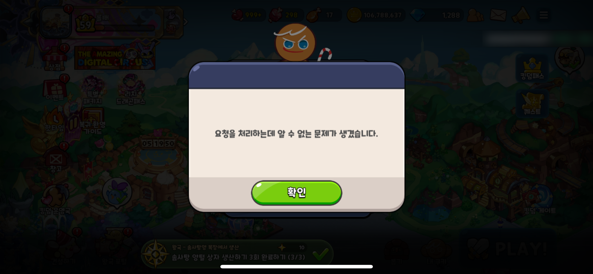 |
| 진행도 3/3 퀘스트의 보상 창 | 보상받기 후 반복되는 오류 창 (다른 플레이어 닉네임 흐림 처리) |

| SUNFALL 직접 플레이 QA | | |
| --- | --- | --- |
| 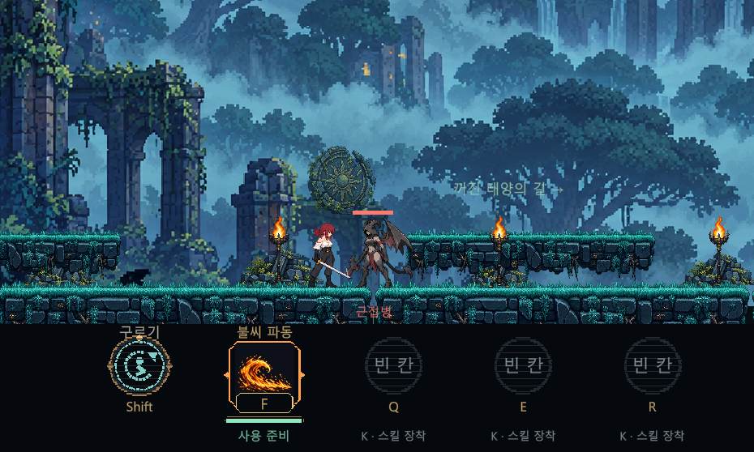 | 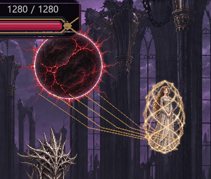 | 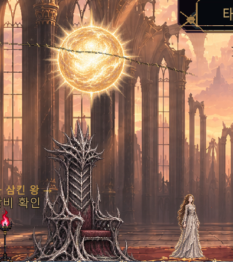 |
| SF-R01 근접해도 재인식하지 않는 적 (P1) | SF-R06 각진 연결선 (P2) | SF-R07 보스 처치 후 결말 미진행 (P1) |

| 메이플스토리 월드 QA 사례 페이지 |
| --- |
| 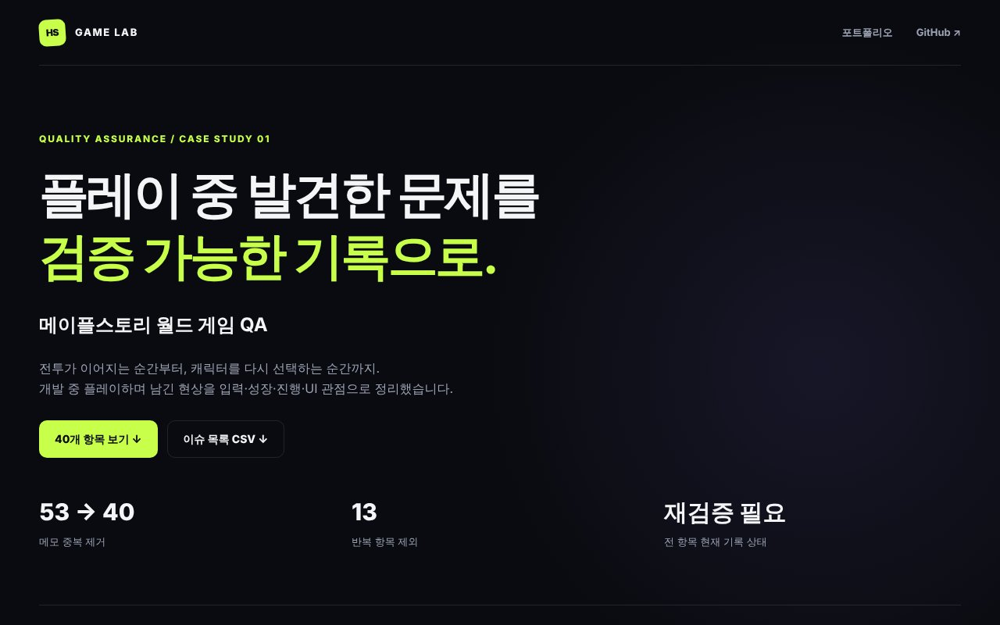 |

## 웹게임 화면

| GAME LAB 홈 | 원카드 AI 대전 |
| --- | --- |
| 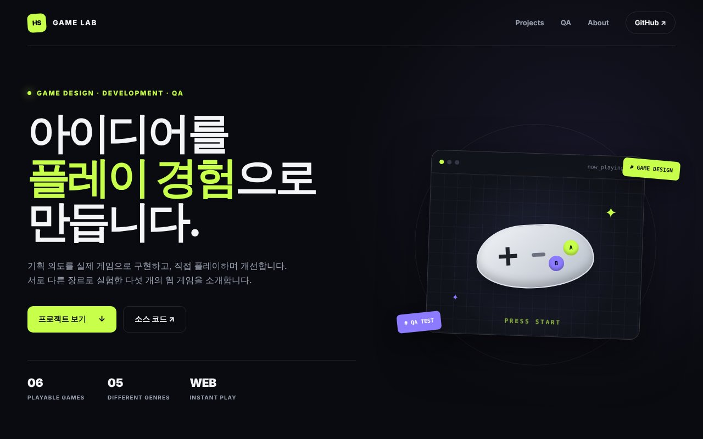 | 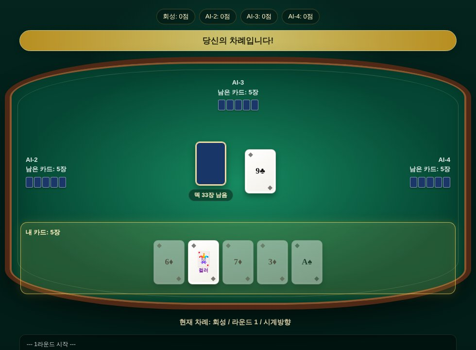 |

| 바둑 입문 문제 | 쇼기 컴퓨터 연습 |
| --- | --- |
| 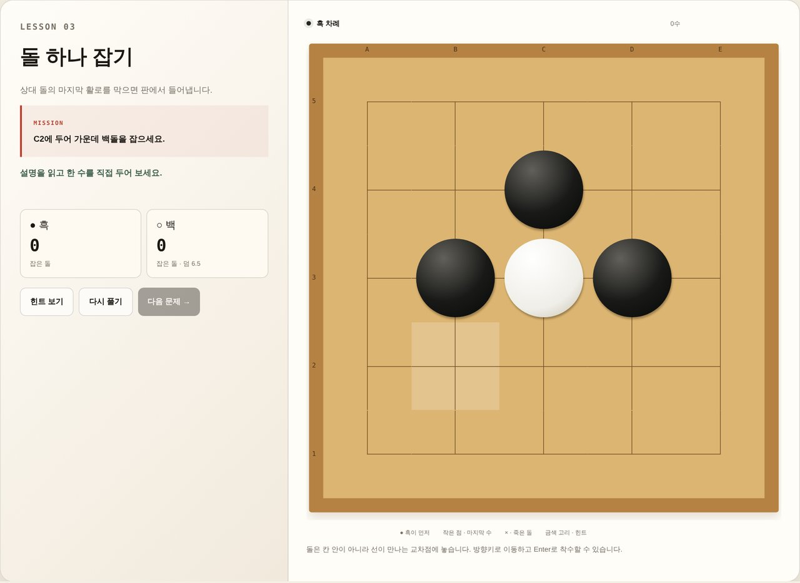 | 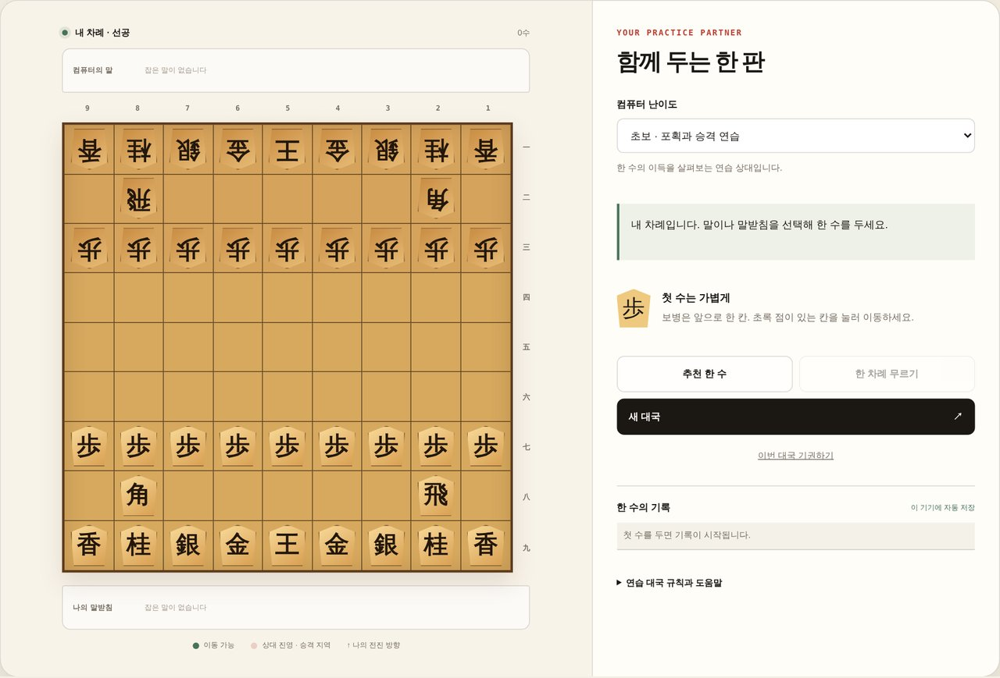 |

| 10년 뒤에 나를 찾아줘 | 핵전쟁 서바이벌 | 생태계교란종 잡기 |
| --- | --- | --- |
| 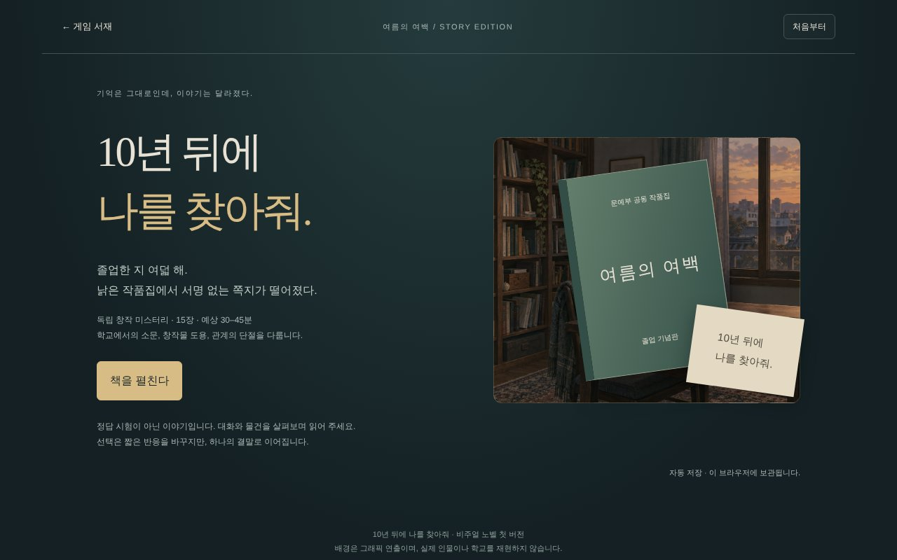 | 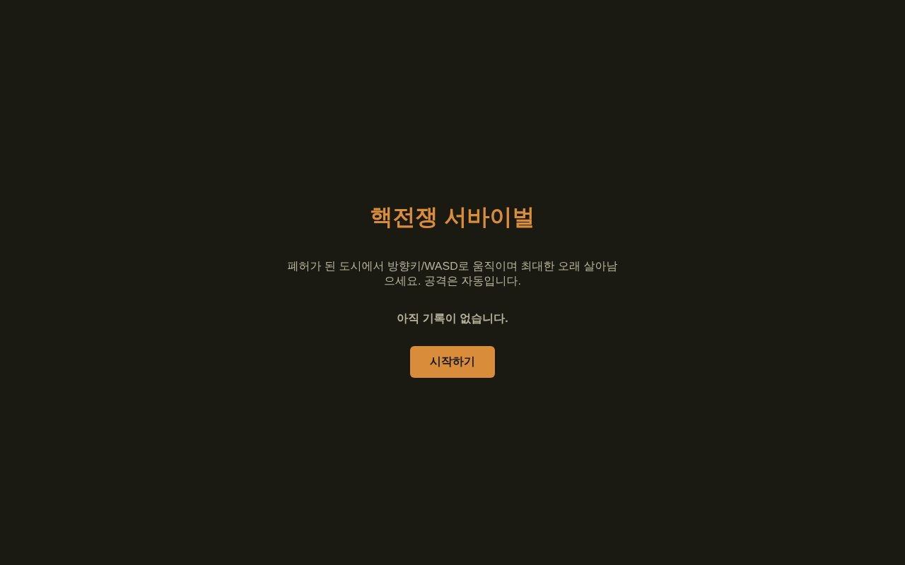 | 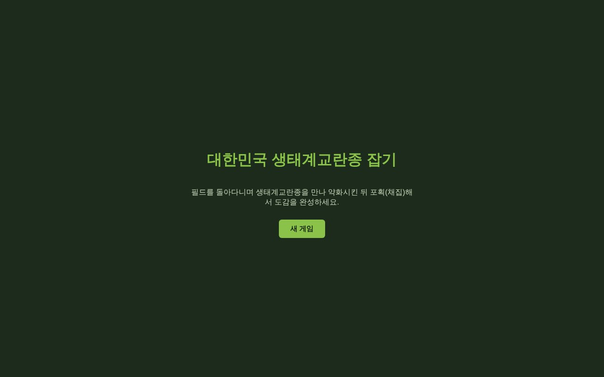 |
