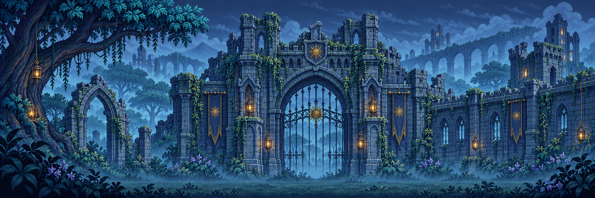

# 아트·UI·수정 이력

[목차](README.md) · 기준 2026-11-03

## 공통 방향

어두운 고딕 세계, 푸른 안개와 낡은 석조, 이끼, 검붉은 악마의 힘, 금빛 별실과 봉합 자국을 사용합니다. 플레이 공간은 도트 캐릭터·도트 배경 중심이고, 대화 초상화와 타이틀은 별도 일러스트입니다.

주인공·악마의 기존 디자인 방향을 유지하면서 사용자 참고 이미지로 캐릭터·의상·공격 동작·마을 NPC를 제작했습니다. 모르가는 이후 요청에 따라 껍질과 뿌리형 비인간 악마로 재설계했습니다.

## 적용한 표현

| 분야 | 적용 내용 |
|---|---|
| 주인공 | 검 1·2·3타, 공중 베기, 준비/베기/회수 중간 프레임, 기준점·배율 보정 |
| 일반 적·보스 | 공격 중간 프레임, 이동 위치 보간, 캐릭터별 고정 크기 |
| 마을 | 불씨 마을 도트 배경, 대장장이·상인·아린, 이름표형 상호작용 |
| 대화 | 주인공·NPC 각 6표정, 1~7층 보스 상황별 초상화 |
| 스킬 | 15종 전용 아이콘과 실제 이미지 이펙트, 불꽃 루프·사슬 반동·입자 |
| 장비 | 5종 이미지, 인벤토리·상점·강화·보상에 표시 |
| 월드 소품 | 포탈·횃불·상자·즉시 회복 물약 이미지 |
| HUD | 고딕 체력바, 스킬 슬롯·쿨타임, 인벤토리·성장·보상 선택창 |
| 타이틀 | 사슬에 묶인 태양과 대성당 배경, 중앙 금빛 SUNFALL 로고, 한국어 부제 |
| 설정 | 조작/소리/화면 버튼 탭, 키 재지정 모달, 음량 게이지와 터치 미리보기 |
| 서장 | 전체 화면 시네마틱, 자막·별실·사슬·입자, 고정 카메라 |
| 처치 | 붉은 입자 소멸, 금빛 하늘 봉합, 포탈과 보물상자 |

## 최근 맵 이미지 교체

### 1스테이지

사각형을 쌓아 그리던 장식을 `ForestRuinPropsV1.png`의 6종 이미지로 교체했습니다.

- 부서진 고딕 아치
- 목재 망루와 붉은 깃발
- 낡은 태양 문양
- 이끼 낀 돌무더기
- 부서진 화단
- 철띠 보급 상자

공유 아치를 사용하는 3·4층 일부에도 이미지 아치가 반영됩니다. 1층 사슬·불씨는 이미지 기반 표현으로 바꾸고 발판 위 직선 테두리는 제거했습니다. 맵의 충돌 좌표는 유지했습니다.

### 2스테이지

기존 녹색 삽화풍 `Stage2CryptRoomsV1`을 현재 `Stage2PixelRoomsV2`로 교체했습니다. 1층 `SunlessForest`를 직접 참고해 전투방 3개와 보스방을 푸른 도트 폐허로 통일했습니다.

봉인 구조물도 `Stage2PixelSealV2`로 재제작했고, 발판은 1층의 `RuinPlatform`을 공유합니다. 봉인 닫힘/열림 이미지의 실제 분리 위치와 바닥 기준점을 보정했습니다. 모르가의 외형·패턴·사슬 절단 타이밍은 유지했습니다.

3~7층 전체 배경까지 새 이미지로 전면 교체한 것은 아닙니다.

## 주요 에셋 위치

아래는 로컬 Unity 프로젝트 `Assets/Sunfall/Resources/` 아래 경로입니다. 이미지 자체도 [게임 프로젝트](../game/Sunfall/Assets/Sunfall/Resources/)에 포함되어 있습니다.

| 경로 | 용도 |
|---|---|
| `World/SunlessForest.png` | 1층 숲 배경·스타일 기준 |
| `World/ForestRuinPropsV1.png` | 새 폐허 소품 아틀라스 |
| `World/Stage2GateHDV3.png`, `Stage2CloisterHDV3.png`, `Stage2SealHallHDV3.png`, `Stage2BossCryptHDV3.png` | 현재 2층 방별 고해상도 배경 |
| `World/Stage2PixelSealV2.png` | 현재 2층 닫힘/열림 봉인 |
| `World/RuinPlatform.png` | 1·2층 도트 석조 발판 |
| `World/EmberVillageV1.png` | 마을 배경 |
| `World/GothicPortalsV1.png`, `GothicTorchesV1.png` | 포탈·횃불 |
| `Demons/Stage2MorgaHuskV2.png` | 모르가 인게임 도트 |
| `Story/BossPortraits/`, `Story/ResidentPortraits/` | 대화 표정 |
| `SkillIcons/`, `Effects/`, `Equipment/` | 스킬 아이콘·이펙트·장비 |
| `Title/ChainedSunBackdropV1.png`, `Title/SunfallWordmarkV1.png` | 타이틀 배경·로고 |

최근 소품과 2층 배경/봉인 이미지는 내장 image_gen으로 생성했고 프로젝트에 실제 PNG로 저장해 Resources 연결을 변경했습니다. 생성 프롬프트와 상세 좌표는 로컬 `docs/FOREST_PROP_REPLACEMENT.md`, `docs/STAGE2_PIXEL_STYLE.md`에 기록되어 있습니다.

## 수정해 온 문제

- 프레임 전환 시 두 이미지를 반투명하게 겹쳐 생기던 캐릭터/NPC 반짝임 제거.
- 검 공격·점프 공격의 크기 변화, 잘림, 발/골반 기준 위치 튐 보정.
- 착지 뒤 공중 공격 상태가 남거나 이동 방향과 회수 방향이 달라지는 문제 수정.
- 스킬이 박스처럼 보이던 표현을 실제 이미지와 애니메이션으로 교체.
- 보스 대화에서 배경 대신 상황별 초상화가 나오도록 연결.
- 첫 화면 GUI 좌표/클리핑 문제와 서장 지속 흔들림 수정.
- 스토리 시청 기록 저장 및 재실행 시 반복 재생 방지.
- 방 몬스터를 건너뛰고 출구로 진행하는 문제, 화면 밖 일반 적 공격 처리 보완.
- 장비 효과의 가시성 보완과 공격 장비 강화 상향.

이는 수정한 내용의 기록입니다. 각 수정의 최종 화면·감각은 사용자 QA로 확인해야 합니다.

## 해상도 후속 개선

네 방을 한 아틀라스로 묶으면서 방별 원본이 1086×362였고, 확대 표시로 픽셀이 거칠어졌습니다. 현재는 각 방을 2172×724 개별 PNG로 재제작하고 1층과 같은 2070×690으로 표시합니다. V2 아틀라스는 과거 에셋으로 보존하지만 로드하지 않습니다.

[전체 생성 프롬프트·검증 기록](../game/Sunfall/docs/STAGE2_HD_BACKGROUNDS.md)
